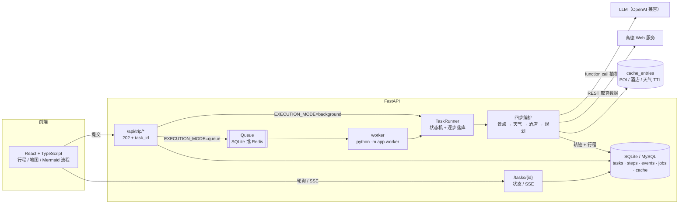
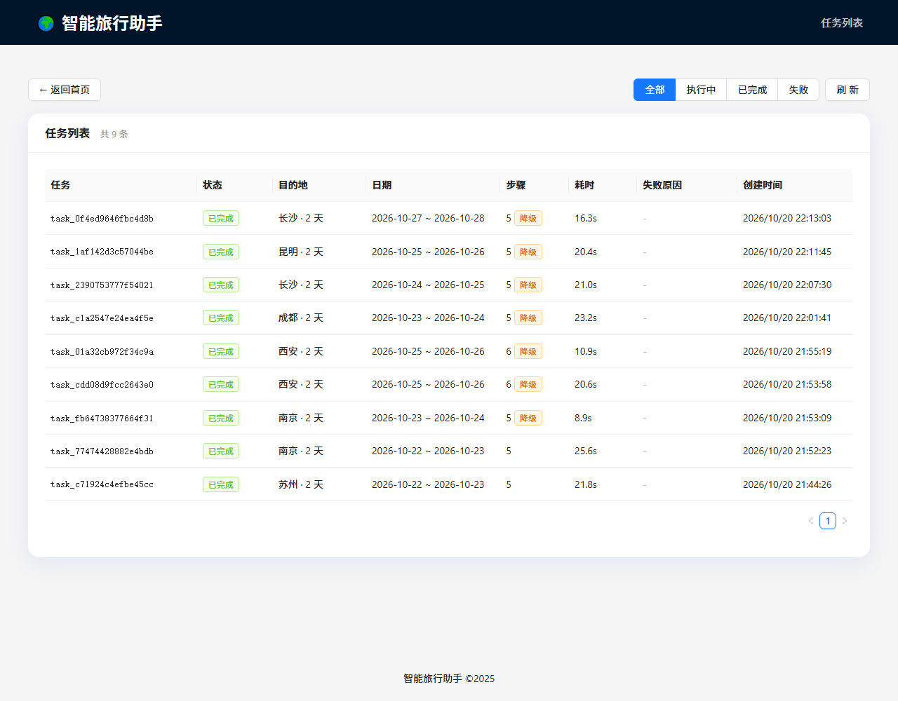
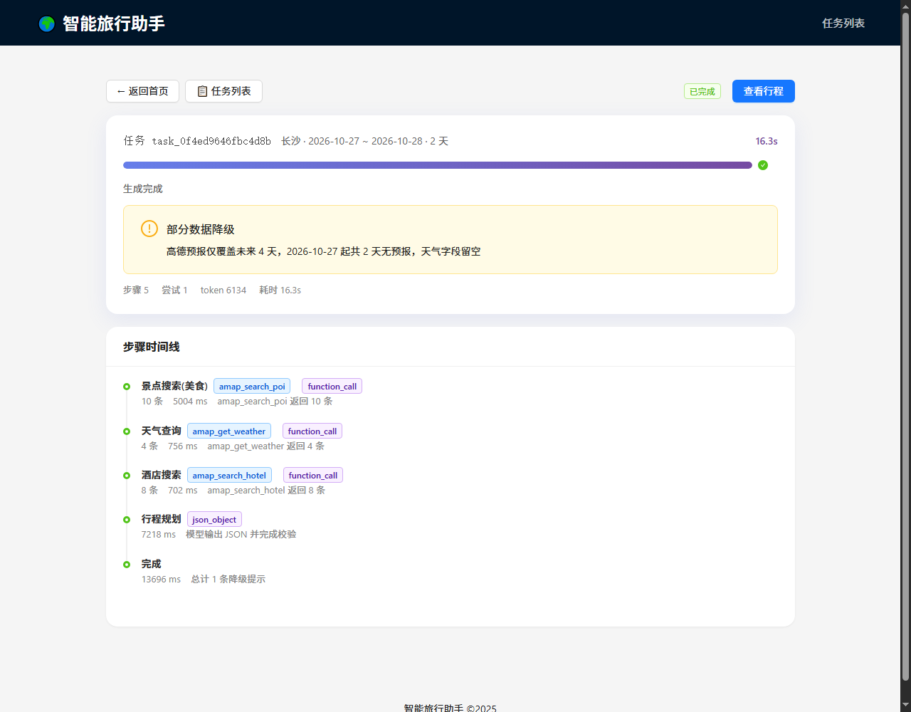
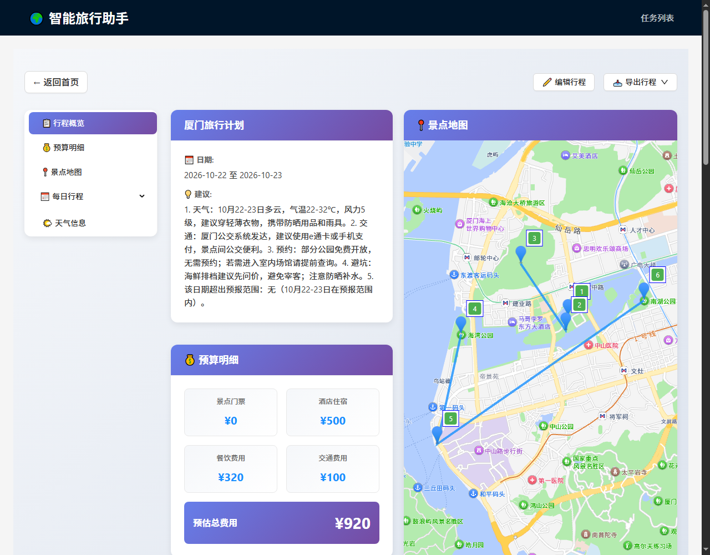

# 智能旅行助手 🌍✈️

FastAPI + React + TypeScript 的旅行规划应用。通过高德 Web 服务查询景点、坐标、地址、评分、天气与酒店，依据可核验地点生成行程，并保存任务状态、执行事件和工具轨迹。

## React 交互工作台

在项目根目录运行 `./start-react.ps1`，访问 `http://127.0.0.1:8772`。首次安装 Python 依赖时使用 `./start-react.ps1 -InstallDependencies`。脚本构建 `frontend-react/` 并启动 FastAPI，页面与接口通过同一地址提供。

- 填写目的地、日期、偏好与住宿条件，提交真实规划任务，接收 SSE 实时进度，查看和取消尚未完成的任务。
- 查看每日景点、真实高德地图、酒店、天气与预算，调整景点顺序并保存在浏览器，下载完整行程 JSON。
- Mermaid 展示景点查询、天气查询、酒店搜索与模型编排的实际步骤，支持缩放、节点详情、参数、返回条数、耗时与历史事件回放。
- 后端读取 `backend/.env` 中的模型与高德 Web 服务配置；浏览器地图读取 `frontend/.env` 中已有的 `VITE_AMAP_WEB_JS_KEY` 与 `VITE_AMAP_SECURITY_JS_CODE`。模型密钥与高德 Web 服务密钥保留在服务端。

前端源码位于 `frontend-react/`，工作台接口位于 `backend/app/api/routes/workbench.py`。前端开发可在 `frontend-react/` 执行 `npm run dev`。

## 一次请求发生了什么


关键点：**工具调用永远由本地代码执行**，模型只输出参数。所以不存在"模型自己编一个断桥残雪的经纬度"这种事。

## 架构



两条执行路径（`EXECUTION_MODE`）：默认 `background` 在 API 进程内跑，开箱即用；
`queue` 交给独立 worker，才有重试、崩溃恢复和多进程并发。

## 与旧实现的差别

| | 旧版（HelloAgents + amap-mcp-server） | 现在 |
|---|---|---|
| 高德调用 | 起 `uvx amap-mcp-server` 子进程 | 直接调高德 Web 服务 REST |
| 工具发现 | 依赖 `uvx`，失败后 `_available_tools=[]` 静默继续 | 工具固定注册，缺失直接报错 |
| 工具协议 | 文本 ReAct（`[TOOL_CALL:...]`）+ 正则解析 | 原生 function calling（`tools` + `tool_choice`） |
| 事件循环 | `asyncio.run()` 撞上 FastAPI 事件循环 | 路由同步 `def`，跑在线程池，不再冲突 |
| 数据可信度 | 模型自由发挥，自己承认"天气是参考值" | 全部高德数据，坐标回填校验 |
| 失败处理 | 静默返回假行程，`success: true` | `degraded` + `warnings` + `trace`，前端黄条提示 |
| 单次耗时 | ~3.5 分钟 | ~20-25 秒 |

## 技术栈

**后端**：FastAPI · pydantic v2 · httpx（高德 REST）· openai SDK（兼容任意 OpenAI 协议端点）
**前端**：Vue 3 + TypeScript · Vite · Ant Design Vue · 高德地图 JS API · html2canvas / jsPDF（导出）

不再依赖：`hello-agents`、`fastmcp`、`uv`（`uvx` 不再是运行前提）。

## 目录结构

```
trip-planner-main/
├── backend/
│   ├── app/
│   │   ├── agents/
│   │   │   ├── tools.py                  # 工具 schema + 本地执行器
│   │   │   └── trip_planner_agent.py     # 四步编排 + 坐标回填 + 降级记录
│   │   ├── api/
│   │   │   ├── main.py                   # FastAPI 入口（lifespan）
│   │   │   └── routes/{trip,map,poi}.py  # 全部同步 def，跑在线程池
│   │   ├── services/
│   │   │   ├── amap_service.py           # 高德 REST 封装（真实解析，错误显式抛）
│   │   │   └── llm_service.py            # function calling + json_object + 兼容降级
│   │   ├── models/schemas.py             # 强类型模型（"90分钟"/"免费" 都能解析）
│   │   └── config.py
│   ├── tests/test_grounding.py           # 名称匹配 / 距离 / 字段容错
│   ├── requirements.txt
│   ├── .env.example
│   └── run.py
└── frontend/
    ├── src/
    │   ├── views/{Home,Result}.vue       # 结果页含降级告警与数据来源统计
    │   ├── services/api.ts
    │   ├── types/index.ts
    │   └── vite-env.d.ts
    ├── .env.example
    └── vite.config.ts                    # /api 代理到 8000
```

## 快速开始

前提：Python 3.10+、Node 18+、**高德 Web 服务 Key**、任意 OpenAI 兼容的 LLM Key。

### 后端

```bash
cd backend
python -m venv venv
venv\Scripts\activate          # Windows；macOS/Linux: source venv/bin/activate
pip install -r requirements.txt
copy .env.example .env         # macOS/Linux: cp
# 填 AMAP_API_KEY / LLM_API_KEY / LLM_BASE_URL / LLM_MODEL_ID
python run.py
```

启动后：

- API 文档 <http://localhost:8000/docs>
- 自检 <http://localhost:8000/api/trip/health> —— 工具、模型、Key、数据库、队列状态
- 指标 <http://localhost:8000/metrics> —— Prometheus 文本

> `LLM_THINKING=disabled`（默认）是给 DeepSeek 系模型用的：思考模式下不支持强制 `tool_choice`。
> 换其他厂商端点时该参数会自动降级，不影响使用。

### 队列与 worker（可选，但故障恢复要靠它）

默认 `EXECUTION_MODE=background`：提交后由 API 进程内的后台任务执行，本机不用多开进程。

想做真正的任务调度（多进程、重试、崩溃恢复），改成队列模式：

```bash
# 1) 后端启动时切换模式
set EXECUTION_MODE=queue          # macOS/Linux: export EXECUTION_MODE=queue
python run.py

# 2) 另开一个窗口跑 worker
python -m app.worker              # 常驻；--once 只处理一轮
```

队列默认走 SQLite（零依赖）；填了 `REDIS_URL` 就自动换成 Redis 实现，业务代码不变。

**故障注入验收**（杀 worker 看任务能不能恢复）：

```bash
powershell -File scripts/fault_kill_worker.ps1
```

脚本会提交任务 → 等 worker 开始跑 → 强杀 worker → 等租约过期 → 重启 worker，
最后断言：任务最终 `succeeded`、`attempt_count>=2`、事件流里有 `task.resumed`。

### 前端

```bash
cd frontend
npm install
copy .env.example .env         # 填 VITE_AMAP_WEB_JS_KEY
npm run dev                    # http://localhost:5300
```

Windows 一键启动：`start.bat`。

## 数据来源对照

| 用途 | 高德接口 | 说明 |
|---|---|---|
| 景点搜索 | `/v3/place/text` | `extensions=all` 拿评分、图片、电话 |
| 天气 | `/v3/weather/weatherInfo` | 需先用 `/v3/geocode/geo` 换 adcode；**只有未来 4 天** |
| 酒店 | `/v3/place/text?types=100000` | `100000`=住宿服务，按到景点群距离排序 |
| 路线 | `/v3/direction/{walking,driving,transit}` | 结果页按当天交通方式自动选择 |
| 景点图片 | POI 的 `photos` 字段 | 前端 `GET /api/poi/photo` |

## 接口

| 方法 | 路径 | 说明 |
|---|---|---|
| POST | `/api/trip/plan` | 提交生成任务，**202** + `task_id`；支持 `Idempotency-Key` |
| GET | `/api/trip/tasks` | 任务列表（可按状态过滤） |
| GET | `/api/trip/tasks/{id}` | 任务状态、步骤、结果 |
| GET | `/api/trip/tasks/{id}/events` | SSE 事件流，`Last-Event-ID` 断线续传 |
| POST | `/api/trip/tasks/{id}/cancel` | 协作式取消 |
| GET | `/api/trip/health` | 工具、模型、Key、数据库、队列自检 |
| GET | `/metrics` | Prometheus 指标（队列深度、缓存命中率、任务分布） |
| GET | `/api/map/poi` | POI 搜索（真实数据） |
| GET | `/api/map/weather` | 天气预报（真实数据） |
| GET | `/api/map/route-between` | 坐标间路线规划 |
| GET | `/api/poi/photo` | 景点图片 |

失败语义：上游不可用 → 502 带原因；数据不完整 → 200 但 `degraded=true`；任务失败 → 任务状态 `failed` + `error.code`。

## 界面

| 任务列表 | 任务详情（步骤时间线） |
|---|---|
|  |  |



提交后立刻跳到 `/task/{id}`，进度由 SSE 推进；跑完自动进行程页。
打开历史任务则停在时间线页（可看每步的工具、条数、耗时、模式），点"查看行程"再进结果页。
地图只依赖行程坐标，所以先起地图、再并行拉图片和路线——不会为了等接口白屏十几秒。

## 运行手册（出问题先看这张表）

| 现象 | 原因 | 处理 |
|---|---|---|
| 启动报 `AMAP_API_KEY未配置` | 没填 `.env` | 复制 `.env.example` 填 Key；CI 里用 `SKIP_CONFIG_VALIDATION=1` 跳过 |
| 提交后一直 `pending` | 用了 `EXECUTION_MODE=queue` 但没起 worker | 另开窗口 `python -m app.worker`，或改回 `background` |
| 提交返回 502 `任务状态: failed` | LLM 或高德调用失败 | 看 `GET /api/trip/tasks/{id}` 的 `error.message`，再看日志里的 `request_id` |
| LLM 报 `Thinking mode does not support this tool_choice` | 模型开了思考模式 | 设 `LLM_THINKING=disabled`（默认已设） |
| 结果里 `degraded=true` | 某一步没取到真实数据 | 看 `warnings`；`data_sources` 里有"几条来自高德" |
| `database is locked` | SQLite 写入竞争 | 已开 WAL + `busy_timeout=15s`；多进程部署请换 MySQL |
| 前端地图空白 | 没配 JS API Key 或没配域名白名单 | `frontend/.env` 填 `VITE_AMAP_WEB_JS_KEY`，控制台加白名单 |
| 端口占用 | 8000/5300 被别的进程占了 | 换 `PORT`，或 `vite --port` |

排查顺序永远是：**`X-Request-Id` → 日志里同一 `request_id` 的全部行 → 该行的 `task_id` → 任务详情**。
一次 run 的每一步（工具、条数、耗时、mode）都在 `GET /api/trip/tasks/{id}` 的 `steps` 里。

## 测试

```bash
cd backend
python -m pytest tests -q --basetemp=.evaluation-work/pytest        # 127 passed
powershell -File scripts/fault_kill_worker.ps1   # 故障注入（需要 EXECUTION_MODE=queue）
```

## Agent 评测

`backend/evaluations` 提供100条旅行规划任务、六类自动评分、冻结高德数据、A/B/C策略比较、确定性故障注入、失败重放和HTML报告。硬约束与软偏好分别保存，缺少价格或开放证据时返回 `unverifiable`。任务成功率同时报告可验证和无法验证样本数。


```powershell
cd backend
pip install -r requirements.txt
python -m pytest tests/test_evaluations.py -q --basetemp=.evaluation-work/pytest
python -m evaluations run --output evaluations/runs/comparison
python -m evaluations report evaluations/runs/comparison
python -m evaluations replay-failures evaluations/runs/comparison --output evaluations/runs/replay
```

默认运行全部任务和三个策略；`--tasks basic-01 faults-01` 选择任务，配置中的 `repeats` 控制重复次数。真实模型实验需要现有模型凭据，离线评分测试和已录制响应重放无需模型服务。评测使用独立进程和实验数据库，Worker基础设施重试与Agent策略恢复分别记录。

数据构建、证据格式、策略行为、指标分母及复现细节见 [评测说明](backend/evaluations/README.md)。

真实模型比较、失败分析、重放验证及两条简历描述见 [实验报告](backend/evaluations/reports/2026-10-23/RESULTS.md)，完整轨迹可在 [HTML报告](backend/evaluations/reports/2026-10-23/report.html) 中筛选查看。

完整100条任务使用 `python -m evaluations run --config evaluations/configs/full.json --output evaluations/runs/full` 执行，三个策略各重复两次，共600次系统执行。版本2.0增加规划前冲突检查、缺失地点的询问答复和连续故障测试，分别统计行程完成、合理拒绝及规则直接答复。完整结果见 [100条任务报告](backend/evaluations/reports/2026-10-23-full/RESULTS.md)。

依据《深入理解 AI Agent》增加重复可靠性、任务配对统计、重新规划组件消融及执行清单提示词实验。重复成绩保留通过、失败、无法验证三种状态；统计区间以任务为抽样单位，保留同一任务的重复记录。重新规划消融使用原始模型响应前缀，执行清单实验另行调用真实模型。方法出处见 [书籍研究](backend/evaluations/book_methods_research.md)，实际成绩与复现命令见 [书籍方法实验](backend/evaluations/reports/book-study-20261024/RESULTS.md)，通俗说明见 [成绩解读](backend/evaluations/reports/book-study-20261024/explainer.html)。

## 已知限制

- **天气只有 4 天**：行程日期超出预报范围时 `weather_info` 留空并在 `warnings` 里说明，绝不编温度。
- **高德不返回房价**：`estimated_cost` 是模型给的参考值（高德 `biz_ext.cost` 有值时会覆盖），前端应标注为参考价。
- **Redis / Docker 未验证**：本机没有 Docker（WSL2 也无法启动），`RedisQueue` 与 `docker-compose.yml` 只有代码交付。
- **没有鉴权**：单人本地使用；上线需要 JWT + 资源归属校验。
- **单机 SQLite**：并发写入靠 WAL + busy_timeout，多机请换 MySQL/Postgres + Redis。

## 下一步（按性价比排序）

1. RAG：城市/场馆知识库 + 向量检索，把用户 `free_text_input` 与知识片段一起喂给规划步。
2. 鉴权：JWT + 资源归属校验，支持多人使用。
3. MySQL / Redis 版本部署验证（依赖 Docker 环境）。

## 许可与致谢

前端交互与页面结构基于 [Datawhale Hello-Agents](https://github.com/datawhalechina/Hello-Agents) 第 13 章示例二次开发；
Agent 层已重写为"原生 function calling + 本地工具执行 + 坐标回填"，不再使用 HelloAgents 框架运行时。

- [高德地图开放平台](https://lbs.amap.com/) — 地图与 POI 服务
- [Datawhale Hello-Agents](https://github.com/datawhalechina/Hello-Agents) — 原始示例与教程

本项目以 [CC BY-NC-SA 4.0](https://creativecommons.org/licenses/by-nc-sa/4.0/deed.zh-hans) 发布，完整条款见 [LICENSE](./LICENSE)。
