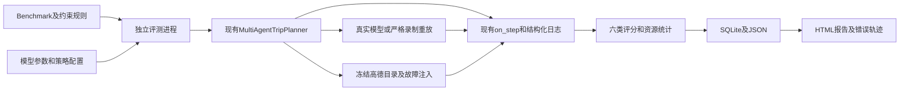

# 旅行规划 Agent 评测

## 执行入口

在 `backend` 目录安装 `requirements.txt` 后执行：

```powershell
python -m evaluations build
python -m pytest tests/test_evaluations.py -q --basetemp=.evaluation-work/pytest
python -m evaluations run --output evaluations/runs/full-comparison
python -m evaluations report evaluations/runs/full-comparison
python -m evaluations replay-failures evaluations/runs/full-comparison --output evaluations/runs/replay
python -m evaluations rerun-failures evaluations/runs/full-comparison --output evaluations/runs/rerun
```

`run` 默认读取已提交的100条任务、冻结高德快照和 `configs/comparison.json`。通过 `--tasks basic-01 faults-01` 选择任务；通过配置文件的 `repeats` 设置重复次数、`parallelism` 设置独立进程并发数量。输出目录必须尚未存在，防止覆盖已有实验。`rerun-failures` 重新调用真实模型，保持原任务、策略、重复编号和快照；`replay-failures` 重放已录制的模型响应，每次请求必须与录制内容在JSON语义上相等。未取得模型响应的网络失败无法完整重放，重放记录会明确包含错误及评分是否一致。

离线评分器测试使用已录制高德数据及明确标注的算术、集合和时间区间输入。测试中的人为输入只验证评分规则。真实模型响应的重放验证与真实模型实验分别记录，重放耗时和 Token 不用于衡量在线性能。

## 模块与生产代码关系



生产 Agent 增加两个可选构造参数 `llm`、`tool_executor`。默认调用路径、提示词、POI回填、任务API和Worker保持原有行为。评测使用现有工具Schema、`TripRequest`、`TripPlan`、`on_step`、`bind_task` 和日志接口。

当前工具顺序由程序指定。Tool Call Grader能够检查模型返回的工具名称与参数是否符合指定接口；自由选择工具和动态编排行为需要Agent具备对应能力后才能评价。

现有Worker提供基础设施租约、退避和崩溃恢复；本评测测量一次Agent执行，每个任务使用全新进程、模型客户端、故障计数和快照副本，基础设施重试次数固定为零。独立进程终止超时任务。实验数据库不连接生产任务数据库，采集过程使用 `.evaluation-work/capture.sqlite`。

## 数据集构建

`benchmark.py` 使用固定日期、城市和场景组合构建100条任务。构建器只生成数据文件。版本控制保留展开后的 `data/benchmark.json`，方便逐条审阅。测试比较构建结果与提交的数据文件，发现手动修改或构建规则变化。

| 分类 | 数量 | 变化维度 |
|---|---:|---|
| basic | 10 | 城市、日期 |
| multi_day | 10 | 2至4天、城市、日期 |
| budget | 10 | 300至4000元、城市、天数 |
| required_pois | 10 | 必选地标及未收录地点 |
| daily_count | 10 | 每天严格1至4个景点 |
| opening | 10 | 必选地标、不同到访日期 |
| infeasible | 10 | 每天至少4个且最多1个的冲突 |
| faults | 10 | 六种故障及城市、日期变化 |
| time_window | 10 | 09:00至17:00到访及开放时间 |
| people | 10 | 2至11位成人 |

任务包含 `task_id/category/difficulty/user_query/constraints/environment_snapshot/grading_config/expected_response`，并保存生产请求结构、软偏好和故障配置。`expected_response`在运行前声明需要生成行程、说明条件冲突或询问未核实地点。每个硬约束声明 `source` 与 `rule`。路线舒适、体验和多样性保存在 `soft_preferences`，不进入确定性成功条件。任务之间包含参数化相似场景；统计分析不能把这些任务视为完全独立的真实用户分布。

## 快照与公平性

`data/snapshot.json` 来自真实高德工具输出，保存采集时间、原始工具参数、返回正文、数据来源和内容哈希。重新采集使用：

```powershell
python -m evaluations capture --output .evaluation-work/new-snapshot.json
```

采集数据库需要尚未存在。重复采集时手动清理该数据库或在独立项目副本执行。采集会复用现有工具的缓存和字段整理；实验始终读取固定快照，不查询实时高德API。

冻结环境采用明确的目录检索语义：限定城市，景点名称、类型或有证据的别名包含关键词；关键词“景点”返回目录全部候选；酒店品牌按名称包含关系过滤。地标附近酒店查询缺少冻结距离证据时抛出 `SnapshotMiss`。这一检索语义适用于所有策略，报告衡量该冻结环境中的Agent表现。

目录未收录地点表示无法匹配本实验的可信候选，不能据此宣称该地点在现实世界不存在。价格、开放日期和营业时段需要单独补充带来源的证据；当前采集器没有产生这些证据。高德返回的酒店 `cost` 不作为完整房价证明。

扩展证据格式：`evidence.opening[poi_id][date]` 保存 `source/open/hours`；`hours` 为ISO时间字符串区间列表。`evidence.prices[date]` 保存 `source/tickets/hotels/meals_per_person/transport_per_person`。门票按POI ID索引，酒店按名称索引，预算按成人数量、房间数、实际游览日期及末日之前的住宿晚数计算。维护者应核实来源覆盖的日期、币种和计价单位；修改证据后更新快照ID及内容哈希。

## 评分规则

| 指标 | 判定及分母 |
|---|---|
| Task Success | 有效日程、所有硬约束和POI有效性全部通过；明确失败优先；缺少必要证据且无明确失败时为unverifiable |
| Task Success Rate | pass / (pass + fail)，同时报告可验证数、无法验证数和pass/全部样本 |
| Constraint Satisfaction | 通过硬约束数 / 可验证硬约束数；无法验证单独计数 |
| POI Validity | 精确名称或来源明确别名、POI ID和坐标一致性；通过数量 / 可验证地点数量 |
| Tool Call | 实际模型工具名、现有JSON Schema、城市一致性、空关键词、执行异常及无效返回字段 |
| Robustness | 实际遇到故障且结果可验证的执行中，最终任务成功的比例；无法验证数量、策略重试和基础设施重试单独记录 |
| Efficiency | 单次Agent耗时、工具调用数、HTTP响应中的完整Token用量和配置价格计算的费用 |

不可满足条件采用预先声明的拒绝规则。结构化答复包含 `response_type/reason/question/conflicts/missing_pois/source`。条件冲突必须有与输入一致且确实矛盾的上下限；未核实地点必须有完整名称的成功查询记录，并与冻结目录的缺失情况一致。随意拒绝普通请求不能通过评分。原始模型输出的旧式 `infeasible=true`、空日程和明确“至少/最多”数量关系也能转换成结构化答复。当前生产数据模型不提供独立人数、房间数、到访时刻和拒绝结构；评测入口保存这些数据，生产API承载结构化询问仍需要独立实现。

缺少任何一次HTTP调用的Token证据时，总Token为unknown。费用仅在Token完整、输入和输出价格及价格来源均提供后计算。未配置价格时显示unknown。服务端模型版本或随机性可能变化；固定temperature和seed无法保证供应商逐字重现，离线响应重放可以检查完全相同请求。

正常执行的耗时从Agent开始规划计量，不含独立进程和模型客户端初始化；达到进程时间限制的执行记录父进程观察到的总等待时间。

错误分类为 `constraint_violation/invalid_poi/tool_selection_error/argument_error/planning_failure/recovery_failure/timeout/unverifiable`。一条执行可以属于多个类别，各类别占比之和可能超过100%。报告展示原始行程、最终行程、工具输入输出、异常、全部HTTP调用、步骤轨迹、评分证据及Agent版本。

## 策略配置

| 配置 | 行为 |
|---|---|
| A | 现有Agent流程和提示词 |
| B | A基础上增加规划前条件检查、必选地点完整名称查询、明确约束核查提示及生成后硬约束校验；确定违规时返回失败 |
| C | B基础上，对失败、空结果或无效字段执行一次工具步骤恢复；规划失败或硬约束违规时带具体反馈重新规划一次 |

三个配置使用相同模型、temperature、seed、工具快照和任务请求。所有模型调用均记录实际请求，SDK自动重试关闭，现有LLM兼容参数处理仍生效。C的额外模型调用计入耗时、Token和工具次数。B和C的硬约束读取Benchmark中的结构化用户条件，规则不读取期待的具体行程。此实验把约束提取视作已知输入。

故障按“工具名称+该工具第几次调用”确定性触发；每次重复从同一计数开始。故障任务的前六条在第一次调用触发故障，后四条在前三次调用连续触发故障。`timeout/network/weather_error` 抛出生产工具使用的 `AmapError`，`hotel_empty/poi_empty` 返回空列表，`invalid_fields` 返回错误字段类型。注入超时立即产生异常，用于测试Agent恢复决策，不模拟真实网络等待时长；其耗时不能代表实际网络超时成本。全任务时间限制单独由父进程执行。

## 结果文件

- `manifest.json`：配置、任务和快照哈希、源代码及Prompt哈希、Git提交、Python和依赖版本。
- `source.json`：实验运行时的应用和评测源代码内容，保留未提交修改的准确版本。
- `benchmark.json/snapshot.json`：实验实际使用的数据。
- `results.sqlite`：逐执行事务持久化；JSON记录同时保存，方便审查和重放。
- `*.partial`：调用进行时的检查点，超时后保留已观察到的数据。
- `summary.json/report.html`：总体比较、故障分组、错误比例与可筛选的完整轨迹。

实验结果可能包含用户输入及外部API返回的公开地点信息；模型密钥和认证请求头不写入轨迹。

## 本地验收与交付

真实验收配置位于 `configs/acceptance.json`：三个独立进程并发，每个策略重复两次。2026年10月23日的验收选择16条任务，覆盖全部10个类别和六种故障：

```powershell
python -m evaluations run --config evaluations/configs/acceptance.json --tasks basic-01 multi_day-01 budget-01 required_pois-01 required_pois-09 daily_count-01 opening-01 infeasible-01 faults-01 faults-02 faults-03 faults-04 faults-05 faults-06 time_window-01 people-01 --output evaluations/runs/acceptance
python -m scripts.verify_evaluation evaluations/runs/acceptance
python -m scripts.export_evaluation evaluations/runs/acceptance --output evaluations/reports/new-study
```

`verify_evaluation` 使用录制模型响应重新执行现有Agent，比较最终行程和全部评分。缺少响应的调用标记无法重放，任何完整录制的不一致会使命令以非零状态结束。`export_evaluation` 要求全部执行完成且重放没有不一致，生成可携带证据压缩包、Markdown真实结果、HTML报告和两条包含实际数值的简历描述。

实际交付数据见 [实验结果](reports/2026-10-23/RESULTS.md) 和 [HTML报告](reports/2026-10-23/report.html)。

## 完整100条任务评测

评测版本2.0使用全部100条任务，三个策略各重复两次，共600次系统执行。使用以下命令，不设置任务筛选参数：

```powershell
python -m evaluations run --config evaluations/configs/full.json --output evaluations/runs/full
python -m scripts.verify_evaluation evaluations/runs/full
python -m scripts.export_evaluation evaluations/runs/full --output evaluations/reports/full
```

实验中断后，可以使用保存的任务、配置及快照继续执行未完成项目，并在结束后自动核验和导出报告：

```powershell
python -m scripts.complete_evaluation evaluations/runs/full --output evaluations/reports/full
```

继续执行时会校验源码、模型名称、任务及快照，保留已完成的记录。未完成尝试的现有JSON和检查点另存于 `interrupted-attempts`。报告记录继续执行的时间与完成数量；中断尝试的额外费用不计入完整执行Token小计，保持未知。`.completion.lock`防止同时启动多个完成进程，进程正常结束时自动移除。

条件冲突可以由B/C的规划前检查直接答复；这些执行单独统计为 `preflight_only_samples`。报告另列真正调用模型的执行数、需要生成行程的任务成功率、需要拒绝或询问的任务正确率、包含进程和客户端初始化的耗时，以及临时故障和连续故障的分组结果。

模型返回拒绝或询问时，答复前会验证它是否有对应证据。无法证实预算不可行、无法提供具体数量冲突、缺少完整名称查询记录等情况，会触发校验失败；C会带具体原因重新规划一次。模型生成的答复来源固定记录为model，规划前程序规则生成的答复来源记录为preflight。

缺少价格与开放记录时，增强策略会在最终建议及warnings中列出尚未核实的条件。已知违反用户游览时段、游览时长不足的安排直接判定失败。实际交通耗时、跨景点移动可行性及旅行体验尚缺少完整证据，当前结果不包含这些能力的确定性评价。

完整实验见 [100条任务报告](reports/2026-10-23-full/RESULTS.md)。历史16条任务实验与完整实验的题目范围和规则版本不同，应分别阅读。

## 书籍方法实验

研究依据为作者官方书籍固定提交 `dbc046eb896ac4e39aa19c7774c8bf49583b89a6` 的第二章、第四章、第七章及第九章。[研究说明](book_methods_research.md)列出逐项来源与适用范围。

- `statistics.py`：经验Pass@k与Pass^k的三种状态聚合、按任务配对bootstrap、按类别整体抽样的敏感性分析、共同可验证任务上的精确McNemar检验。无法验证样本单独计数，并提供未知样本导致的成功比例识别上下界。
- `book_policy.py`：可配置的执行流程与条件清单提示方式，以及仅关闭重新规划的组件开关。生产Agent默认提示词保持现有配置。
- `scripts/book_evaluation.py`：分析完整600次记录；重放相同调用前缀执行消融；在相同模型和冻结工具数据上执行C/W配对实验；保存实验登记、代码、数据、全部响应、统计与HTML报告。

```powershell
python -m scripts.book_evaluation analyze evaluations/runs/full-20261023-final --output evaluations/reports/book-study-20261024
python -m scripts.book_evaluation run evaluations/runs/full-20261023-final --output evaluations/reports/book-study-20261024/trial
python -m scripts.book_evaluation finish evaluations/reports/book-study-20261024/trial
```

`analyze`覆盖全部100条任务的历史重复成绩，并对C的200次记录执行前缀消融；录制不完整的记录保持无法验证。消融只支持已观察响应前缀上的条件结论，不使用离线重放耗时估计线上成本。

`run`采用每日数量与故障两类共20条开发诊断任务，C/W各运行三次，种子42/43/44、temperature=0，共120次真实执行。两种配置都使用C的恢复预算和相同人工标注条件。W统一每日数量规则、补充执行流程与条件清单；实验评价这一组提示词改动的整体影响。每个任务与种子配对，两组顺序平衡，任务对使用固定种子打乱。主要比较指标在调用前登记为W相对C的已确认成功比例差值。

`finish`使用完全相同源码核验全部完整录制响应，比较最终行程、答复和评分，再生成统计报告。缺失响应与重放差异分别处理。实验目录必须保持独立；再次调用真实模型时使用新的输出目录。固定低温和种子无法保证供应商独立随机采样，这20条已参与开发的任务也不能支持未见任务泛化结论。费用缺少核实单价时保持unknown。

实际结果见 [书籍方法实验报告](reports/book-study-20261024/RESULTS.md) 与 [C/W轨迹报告](reports/book-study-20261024/trial/report.html)。
